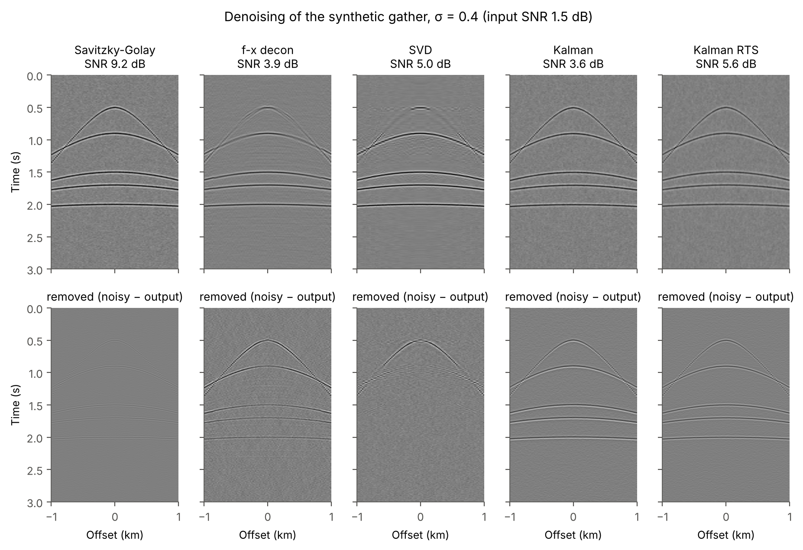
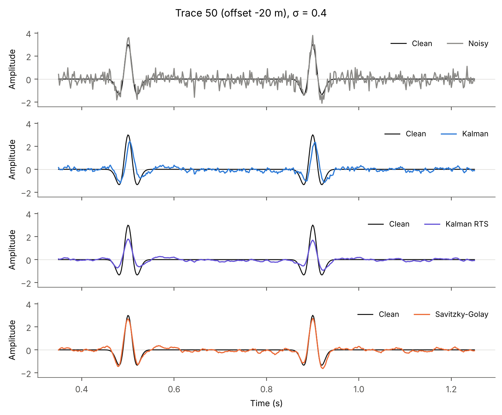
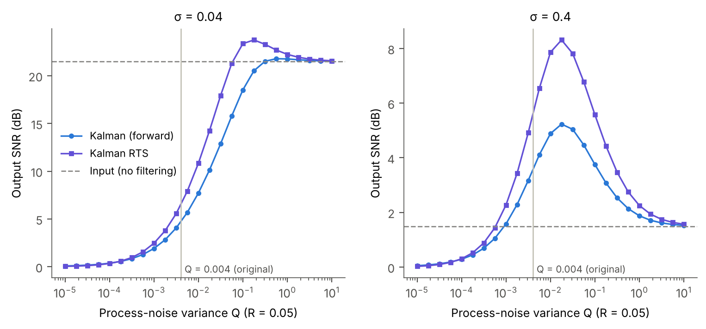
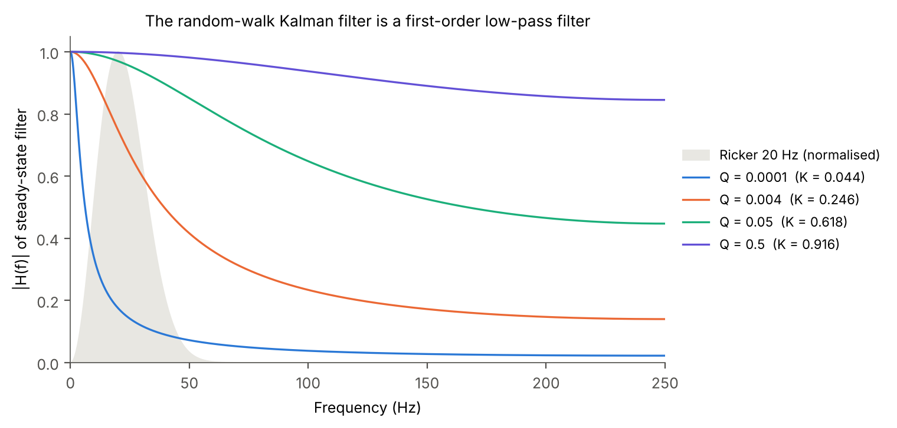
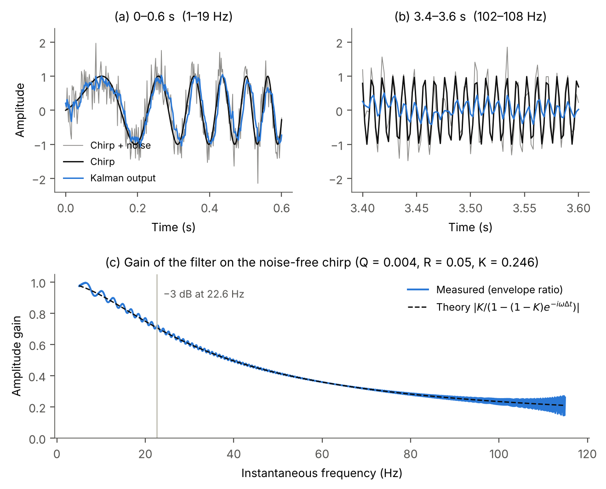
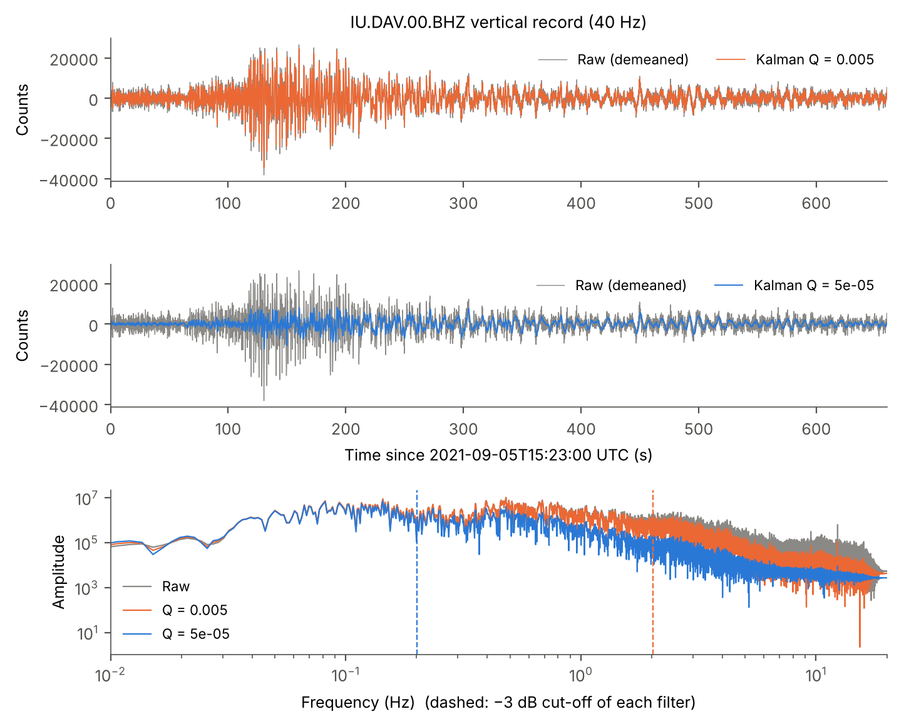

# Kalman-filter denoising of seismic data

[](https://github.com/MohammadAmin-Aminian/kalman-seismic-denoising/actions/workflows/ci.yml)
[](LICENSE)

Random-noise attenuation of seismic traces with a **scalar random-walk Kalman
filter**, compared with Savitzky–Golay smoothing, f-x deconvolution and SVD
(eigenimage) filtering, in **Python and MATLAB** with identical methods,
parameters and data.

This is the cleaned, corrected and fully reproducible version of a
master's research project (2021). There is no associated paper. Every
change from the original scripts is listed in
[`docs/CORRECTIONS.md`](docs/CORRECTIONS.md).

---

## Summary

* Each trace is filtered with the model *x<sub>k</sub> = x<sub>k−1</sub> + w*,
  *z<sub>k</sub> = x<sub>k</sub> + v* (Var *w* = Q, Var *v* = R).
* **Key finding:** with fixed Q and R the Kalman gain converges in a few
  samples to a constant *K*. The filter then becomes the first-order recursive
  low-pass filter *x<sub>k</sub> = (1−K) x<sub>k−1</sub> + K z<sub>k</sub>*.
  The repository derives this, verifies it numerically and shows what it
  implies (Figs. 8–9):
  * With the original Q = 0.004, R = 0.05: K = 0.246, the −3 dB cut-off is
    22.6 Hz (at 2 ms sampling), and the group delay at low frequencies is
    about 3 samples (6 ms).
  * The cut-off sits at the peak of the 20 Hz Ricker wavelet, so the filter
    removes signal together with noise and delays it.
* **Results on the synthetic gather** (output SNR in dB, higher is better):

| Method | σ = 0.04 | σ = 0.4 |
|---|---:|---:|
| Input (noisy) | 21.48 | 1.48 |
| Savitzky–Golay (order 4, 27 samples) | **15.69** | **9.16** |
| f-x deconvolution (8-point operator, 0–100 Hz) | 4.85 | 3.89 |
| SVD (rank 18) | 7.67 | 5.05 |
| **Kalman (Q = 0.004, original setting)** | 4.67 | 3.56 |
| Kalman RTS smoother, Q = 0.004 *(extension)* | 6.45 | 5.58 |
| Kalman, best Q from sweep | 21.78 (Q ≈ 0.56) | 5.23 (Q ≈ 0.018) |
| Kalman RTS, best Q from sweep *(extension)* | **23.75** (Q ≈ 0.18) | **8.32** (Q ≈ 0.018) |

  SNR = 10 log₁₀(Σ clean² / Σ (output − clean)²). Numbers come from
  [`results/snr_table.md`](results/snr_table.md) and are regenerated by the
  scripts below.
* **Honest reading of the table:**
  * At low noise (σ = 0.04) every method with its original parameters
    *lowers* the SNR, because signal distortion dominates.
  * At high noise (σ = 0.4) all methods help. The Kalman filter with its
    original Q gains 2 dB and is the weakest of the four.
  * Tuning Q and using the zero-phase RTS smoother (an extension, not part of
    the original study) brings it close to Savitzky–Golay.
* **Earthquake record** (IU.DAV BHZ, 40 Hz):
  * The original setting Q = 5·10⁻⁵ is a 0.20 Hz low-pass. It keeps only 43%
    of the RMS amplitude and removes most of the body-wave energy.
  * Q = 0.005 (a 2.0 Hz low-pass) keeps 92%.

## Method

**State-space model** (one independent model per trace; Welch & Bishop, 2006):

```
x_k = x_{k-1} + w_k,   w_k ~ N(0, Q)        state: clean sample
z_k = x_k + v_k,       v_k ~ N(0, R)        observation: recorded sample
```

**Recursion**, for k = 1 … N, starting from the prior (x₀, P₀):

```
P_k^- = P_{k-1}^+ + Q                     (no Q added for k = 1)
K_k   = P_k^- / (P_k^- + R)
x_k^+ = x_{k-1}^+ + K_k (z_k - x_{k-1}^+)
P_k^+ = (1 - K_k) P_k^-
```

**Steady state.** The variances don't depend on the data. Therefore
P⁻ → (Q + √(Q² + 4QR)) / 2 and K → P⁻ / (P⁻ + R), and the filter becomes
`H(z) = K / (1 − (1−K) z⁻¹)`. Only the ratio Q/R matters: the filter is
linear, so scaling the data doesn't change K.

**Comparison methods:**
* Savitzky–Golay: least-squares polynomial smoothing along time.
* f-x deconvolution (Canales, 1984): forward and backward spatial prediction
  at each frequency.
* SVD: rank-r reconstruction of the gather.
* *Extension:* the Rauch–Tung–Striebel smoother runs the same model forward
  and then backward, which removes the phase lag.

## Key figures

| | |
|---|---|
|  |  |
| **Fig. 2** Outputs (top) and removed energy (bottom) at σ = 0.4. Signal visible in the bottom row is signal the method removed. | **Fig. 4** Trace 50: the causal Kalman output is attenuated and delayed. The RTS smoother removes the delay. |
|  |  |
| **Fig. 7** Output SNR against Q. The original Q = 0.004 is far below the optimum at σ = 0.04. | **Fig. 8** Frequency response of the steady-state filter compared with the 20 Hz Ricker spectrum. |
|  |  |
| **Fig. 9** Known-answer test: the gain measured on a chirp matches the theoretical H(f) to within 0.032. | **Fig. 10** Earthquake record with Q = 0.005 and Q = 5·10⁻⁵ (dashed lines: −3 dB cut-offs). |

All figures are in [`figures/`](figures): gathers (1), method comparison at
both noise levels (2–3), trace comparison (4), amplitude spectra (5), f-k
spectra (6), Q sweep (7), filter response (8), chirp validation (9) and
earthquake (10). MATLAB writes the same set to `figures/matlab/`.

## Installation

**Python ≥ 3.9**

```bash
git clone https://github.com/MohammadAmin-Aminian/kalman-seismic-denoising.git
cd kalman-seismic-denoising
python -m venv .venv && source .venv/bin/activate      # Windows: .venv\Scripts\activate
pip install -e ".[test]"                               # or: pip install -r requirements.txt
```

**MATLAB R2019b or newer.** Only base MATLAB is needed: no toolboxes and no
installation step.

## How to run

**Python**

```bash
python scripts/reproduce_all.py          # all numbers -> results/, all figures -> figures/
python scripts/reproduce_all.py --no-figures
pytest                                   # 19 tests
python tools/original_port.py            # comparison with the original code
```

```python
from kalman_denoise.kalman import kalman1d, kalman_rts, steady_state
x = kalman1d(noisy, Q=0.004, R=0.05)          # traces in columns
print(steady_state(0.004, 0.05)["K"])         # 0.2457
```

**MATLAB**

```matlab
cd matlab
reproduce_all                  % numbers -> results/*_matlab.*, figures -> figures/matlab/
results = runtests('tests');   % 18 tests, incl. parity with Python
```

```matlab
addpath matlab/src
x = kalman1d(noisy, 0.004, 0.05);
```

The Python run takes about 20 s and writes `results/metrics.json`,
`results/snr_table.md` and `figures/fig01…fig10`.

## Configuration

Both languages read [`config/default.json`](config/default.json). Units are
seconds, metres and Hz.

| Key | Meaning | Value |
|---|---|---|
| `synthetic` | dt, length, Ricker f0, offsets, τ, v and amplitude of the 5 hyperbolas | 2 ms, 3 s, 20 Hz, ±20–1000 m step 20 m |
| `noise.sigma_levels` | noise standard deviations | 0.04, 0.4 |
| `kalman` | Q, R, P0, x0 | 0.004, 0.05, 1.01, 0 |
| `savgol` | polynomial order, frame length | 4, 27 |
| `fx` | operator length, damping (%), band | 8, 0, 0–100 Hz |
| `svd.rank` | eigenimages kept | 18 |
| `sweep` | log₁₀ Q range and number of points | −5 … 1, 25 |
| `chirp` | sampling, duration, start/end frequency, σ | 2 ms, 4 s, 1–120 Hz, 0.4 |
| `earthquake` | file, Q, alternative Q, R | 5·10⁻⁵, 0.005, 0.05 |

Pass another file with `--config my.json` (Python) or
`reproduce_all('config', 'my.json')` (MATLAB).

## Repository layout

```
config/default.json          shared parameters
data/                        noise fields + earthquake record (.mat v5) - see data/README.md
src/kalman_denoise/          Python package
  kalman.py                  kalman1d, kalman_rts, steady_state, ewma_response, cutoff_frequency
  baselines.py               savgol_filter, fx_decon, svd_denoise
  synthetic.py               ricker, hyperbolic_gather, chirp_signal
  spectra.py, metrics.py     amplitude/f-k spectra, SNR
  pipeline.py, reproduce.py  experiments and figure/number generation
  plotting.py
matlab/
  src/                       same functions, base MATLAB (kalman1d.m, fx_decon_filter.m, ...)
  reproduce_all.m            regenerates every number and figure
  tests/TestKalmanDenoise.m  unit, known-answer and Python-parity tests
scripts/reproduce_all.py     Python entry point
tests/                       pytest suite + reference outputs for MATLAB parity
tools/                       make_data.py, make_reference.py, original_port.py
results/                     metrics.json, snr_table.md, original_comparison.md
figures/                     PNG figures (Python); figures/matlab/ (MATLAB)
docs/CORRECTIONS.md          every correction relative to the original code
legacy/                      original 2021 scripts (reference only)
```

## Validation

* **Known answers (both languages):**
  * The gain converges to the closed-form value (error < 10⁻¹²).
  * After convergence the output equals the first-order recursion (< 10⁻⁹).
  * On data simulated from the model itself, the measured MSE equals the
    theoretical posterior variance P⁺ to within 3%, and the RTS smoother
    lowers it further.
  * Savitzky–Golay reproduces degree-4 polynomials exactly and matches SciPy
    to within 10⁻¹⁰.
  * f-x deconvolution improves the SNR of plane waves by more than 8 dB.
  * A rank-1 matrix is recovered exactly by the SVD filter.
  * The −3 dB cut-off formula is exact.
* **Chirp test (Fig. 9):** the measured gain matches |H(f)| from 5 to 115 Hz
  with a maximum error of 0.032.
* **Python ↔ MATLAB parity:**
  * The MATLAB tests compare against `tests/reference/python_reference.mat`:
    the Kalman filter and smoother on the chirp, the gather, all method
    outputs, the SNR tables, the Q sweep, the spectra and the earthquake
    numbers.
  * Tolerances are 10⁻¹² for the Kalman recursions, 10⁻⁸ (relative) for the
    other method outputs and 10⁻⁶ dB for the SNRs.
* **Against the original code** ([`results/original_comparison.md`](results/original_comparison.md)):
  * A faithful port of `kalman_26_sep.m`, bugs included, run on the same
    noise gives the same SNRs as the corrected code within 0.01 dB once the
    SNR formula is corrected. The code changes therefore don't alter the
    method.
  * With the *original* SNR formula the numbers are much lower, e.g. Kalman
    2.08 dB instead of 4.67 dB.
  * Of the SNR values written in the original figure titles, only the Kalman
    value (7 dB; port 6.86 dB) can be reproduced. The others don't follow
    from that script's parameters.
* **Regression test:** `pytest` checks that `results/metrics.json` is
  reproduced to within 10⁻⁶ dB.
* **CI:** every push runs the Python tests on Python 3.9, 3.11 and 3.13 and the MATLAB tests
  on R2023b, then regenerates the figures in both languages as build
  artifacts.

## Corrections

The full list is in [`docs/CORRECTIONS.md`](docs/CORRECTIONS.md). The most
important ones:

1. **SNR formula:** the original used the output instead of the clean signal
   in the numerator. All original SNR values were affected.
2. **Frequency axes:** spectra were plotted with a 3× wrong frequency scale,
   so the 20 Hz Ricker peak appeared at 60 Hz.
3. **f-k axes:** the f-k spectra used dt = 1 ms and dx = 12.5 m for data
   sampled at 2 ms and 20 m.
4. **f-x band:** f-x was called with the wrong dt. The band is now explicit
   (0–100 Hz, which keeps the band the original actually used).
5. **`Kalman1D` robustness:** NaN handling shifted samples, and the first
   sample was never updated.
6. **Earthquake data:** a meaningless single-trace f-k spectrum and a
   spectrum on a 0–1000 "Hz" axis for 40 Hz data were replaced, and the wrong
   units were fixed.
7. **Missing function:** the undefined `kalman(…)` call is now `kalman1d`
   with Q = 5·10⁻⁵.
8. **Reproducibility:** unseeded random noise was replaced with stored noise
   shared by both languages.
9. **Chirp test:** the aliased chirp (and uniform noise labelled
   "Gaussian") was rebuilt as a proper known-answer test.

## Limitations

* **Model:**
  * The random-walk model has no notion of oscillation, so it can only act as
    a low-pass filter (Fig. 8).
  * A model matched to seismic wavelets (e.g. an AR(2) or harmonic state)
    would be needed for a real advantage over classical filters. That is
    outside the scope of this repository.
* **Parameters:**
  * Q and R are fixed by hand.
  * The best Q depends strongly on the noise level (Fig. 7), and no rule for
    choosing it is given.
* **Real data:**
  * The real shot gathers (`shot1.sgy`, `shot20.sgy`) were not available, so
    the real-data experiments of the original project are not reproduced.
  * The earthquake record has no ground truth. It is only characterised, not
    scored.
* **Unreproduced material:**
  * `VRE` ("Kalman + VRE") could not be reproduced (function missing).
  * Some original figures (a 121-trace gather with "Trace 57") have no
    matching script or data and are not reproduced.
* **f-x deconvolution:** applied without spatial windows, as in the
  original. It is therefore at a disadvantage on curved events. It works as
  expected on plane waves (unit test).
* **Python/MATLAB differences:** the MATLAB implementation was written to
  mirror the Python one and is verified by CI against stored Python outputs.
  Small differences (~10⁻¹²) from floating-point summation order are
  expected.

## Citation

There is no paper. If you use this code, please cite the repository (see
[`CITATION.cff`](CITATION.cff)):

```bibtex
@software{aminian_kalman_seismic_denoising,
  author  = {Aminian, Mohammad-Amin},
  title   = {Kalman-filter denoising of seismic data (Python and MATLAB)},
  year    = {2026},
  version = {1.0.0},
  url     = {https://github.com/MohammadAmin-Aminian/kalman-seismic-denoising}
}
```

**References:**
* Welch, G. & Bishop, G. (2006). *An Introduction to the Kalman Filter*. UNC-Chapel Hill, TR 95-041.
* Rauch, H. E., Tung, F. & Striebel, C. T. (1965). Maximum likelihood estimates of linear dynamic systems. *AIAA Journal*, 3(8), 1445–1450.
* Canales, L. L. (1984). Random noise reduction. *SEG Technical Program Expanded Abstracts*, 525–527.
* Savitzky, A. & Golay, M. J. E. (1964). Smoothing and differentiation of data by simplified least squares procedures. *Analytical Chemistry*, 36(8), 1627–1639.

The earthquake record belongs to the Global Seismograph Network,
doi:[10.7914/SN/IU](https://doi.org/10.7914/SN/IU) (see [`data/README.md`](data/README.md)).

## License

Code: [MIT](LICENSE). The GSN waveform in `data/` is redistributed under the
open data policy of the EarthScope Consortium (formerly IRIS); please cite the
network as above.
